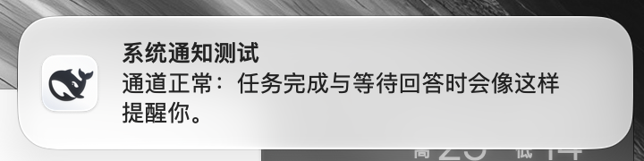

# System notifications

A DeepSeek Harness plugin that turns Host events into operating-system
notifications, so a task that finishes while you are in another application
still reaches you.



| Event | Notification |
| --- | --- |
| `turn/end` with reason `completed` | The turn finished; the body previews the closing answer. |
| `turn/end` with reason `max-tokens` | The turn stopped at the output limit. |
| `turn/end` with reason `error` | The turn failed. |
| `user-questions/request` | The agent asks you a question. |
| `approval/request` | A tool is waiting for your permission. |

Requests only notify when they are **still unanswered** after `requestGraceMs`
(default 1200 ms), so an auto-approving policy — or a user already reading the
prompt — stays silent. The question and approval listeners never claim the
request: they delegate with `next()` and return its answer unchanged.

Aborted, interrupted, forked, and blocked turns never notify: they are the
user's own action or a hand-off, not a result to report.

## Install

Clone this repository, then add it to your DSH profile as a linked dependency and
select the `dsh-system-notify` bundle:

```json
"@local/dsh-system-notify": "link:/absolute/path/to/dsh-system-notify"
```

The bundle name is `@local/dsh-system-notify`; after the next load notifications
start. Or install with the CLI:

```bash
dsh plugin --profile desktop add github:LXD-8/dsh-system-notify
```

## Delivery

A connected Web page renders the notification itself, through the browser
Notification API. The operating system then attributes it to DeepSeek Harness,
so macOS draws the application icon and lists the application under
Settings → Notifications. The page holds `/dsh-system-notify/events` open
(Server-Sent Events) and connects with `?notify=granted` only when it can
actually raise notifications.

Without such a page — a headless Host, or a browser that denied permission —
the plugin falls back to a platform command:

- **macOS** — `osascript` `display notification` (sound `Glass` by default).
- **Linux** — `notify-send`.
- Other platforms keep the plugin installed and silent.

That fallback still works with no page open, but the operating system attributes
it to the helper process, so macOS draws a generic script icon instead of the
application's.

On the first notification macOS asks once whether DeepSeek Harness may notify;
allow it in that banner or in Settings → Notifications → DeepSeek Harness.

While DeepSeek Harness is the frontmost macOS application the notification is
suppressed: watching the conversation already shows what happened. The
frontmost name is read with `lsappinfo`, which needs no automation permission;
an unreadable value fails open and the notification is delivered.

Clicking a page notification focuses the window and opens the Session it came
from.

## Configuration

All keys are optional; the defaults below are what the bundle inserts. They are
the plugin's Config schema, edited from the plugin's own row in Plugins or in
the profile patch.

```yaml
- insert:
    - id: dsh-system-notify
      name: '@local/dsh-system-notify'
      config:
        turnComplete: true       # notify when a turn completes
        turnMaxTokens: true      # notify when a turn stops at the output limit
        turnError: true          # notify when a turn ends in an error
        userQuestion: true       # notify when the agent asks a question
        approval: true           # notify when a tool waits for permission
        subagents: false         # include subagent Sessions
        sound: true              # play the notification sound
        skipWhenForeground: true # stay quiet while Harness is frontmost (macOS)
        foregroundApps: ['DeepSeek Harness', 'Electron']
        requestGraceMs: 1200     # how long a request may stay unanswered
```

## Routes

| Route | Purpose |
| --- | --- |
| `GET /dsh-system-notify/events` | Server-Sent Events stream of notifications for the page. |
| `GET /dsh-system-notify/status` | `{ clients, notifying }` — which delivery path the next notification takes. |
| `POST /dsh-system-notify/test` | Raise one sample notification through the normal path. |

```bash
curl -X POST http://127.0.0.1:65263/dsh-system-notify/test
```

## License

MIT
